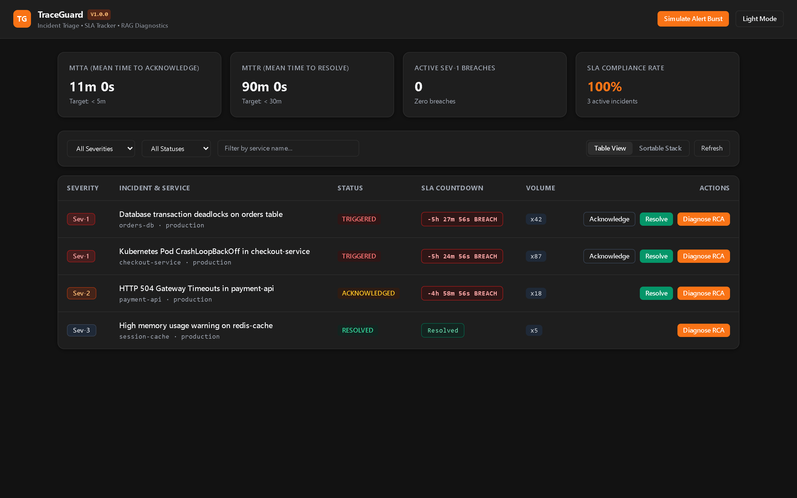
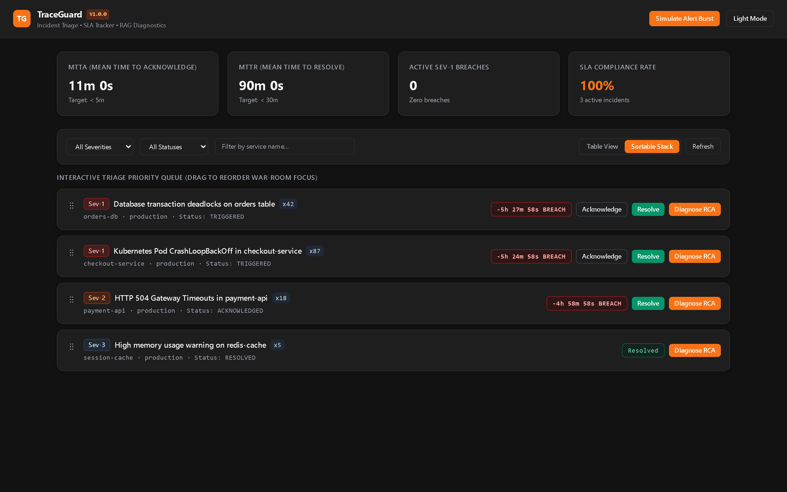
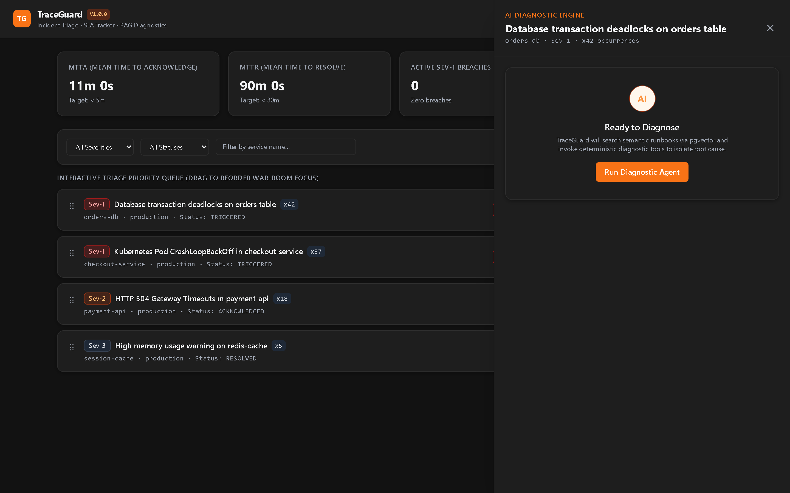

# TraceGuard

TraceGuard is an incident triage and Site Reliability Engineering (SRE) diagnostics platform. It ingests high-velocity service alerts, deduplicates noisy bursts using Redis sliding windows, prioritizes critical incidents via PostgreSQL lock-free queues, and runs an automated Root Cause Analysis (RCA) engine combining `pgvector` semantic runbook search with deterministic diagnostic tools.

---

## UI Previews

### Incident Command Center


### Interactive Motion Sortable Stack


### AI RCA Inspector Drawer


---

## Architecture

```
Alert Sources (Prometheus, CloudWatch, Custom)
       |
       v
Webhook Ingestion (Strategy Pattern Parser)
       |
       v
Redis Sliding-Window Deduplicator (ZSET)
       |
       v
PostgreSQL 16 (Relational Store + pgvector HNSW)
       |
       +-------------------------------+
       |                               |
       v                               v
Concurrent Priority Worker      FastAPI REST API
(SELECT FOR UPDATE SKIP LOCKED) (JWT Auth & SLA Analytics)
       |                               |
       v                               v
RAG & Diagnostic Agent          React 18 + TS UI
(pgvector + Tool Registry)      (Motion Sortable Stack)
```

---

## Core Capabilities

- **Alert Ingestion & Deduplication:** Strategy pattern normalizes Prometheus, CloudWatch, and custom log payloads. A Redis `ZSET` sliding window suppresses duplicate alert storms into a single ticket with an incrementing occurrence counter.
- **Lock-Free Priority Worker Queue:** Async workers use PostgreSQL `SELECT ... FOR UPDATE SKIP LOCKED` with `CASE` severity ordering so `Sev-1` incidents immediately preempt lower-priority tasks without lock contention.
- **Single-Pass SLA Analytics:** Calculates Mean Time to Acknowledge (MTTA), Mean Time to Resolve (MTTR), active SLA breaches, and compliance percentage in a single SQL pass.
- **RAG & Deterministic Diagnostic Engine:** Searches Markdown runbooks via `pgvector` cosine similarity and runs read-only system inspection tools (database locks, pod crashloops, error rate telemetry) before producing a structured Pydantic root cause report.
- **Motion Sortable Stack:** Built with `motion/react` spring physics, allowing engineers to drag-and-drop incidents to reprioritize war-room focus and re-order AI-recommended remediation steps with full undo history.

---

## Tech Stack

- **Backend:** Python 3.11+, FastAPI, SQLAlchemy 2.0 (async), Pydantic v2, PostgreSQL 16 with `pgvector`, Redis 7
- **Frontend:** React 18, TypeScript (strict, zero `any`), Tailwind CSS, Motion (`motion/react`), Vite
- **Testing & Infra:** `pytest`, Docker Compose

---

## Quickstart

### Run with Docker Compose
```bash
docker compose up --build
```
- Frontend UI: `http://localhost:3000`
- Backend API Docs: `http://localhost:8000/docs`

### Run Locally

#### 1. Backend
```bash
cd backend
python -m venv venv
# Windows:
.\venv\Scripts\activate
# Linux/macOS:
source venv/bin/activate

pip install -r requirements.txt
uvicorn app.main:app --reload --port 8000
```

#### 2. Run Tests
```bash
python -m pytest
```

#### 3. Frontend
```bash
cd frontend
npm install
npm run dev
```
Open `http://localhost:5173`.
